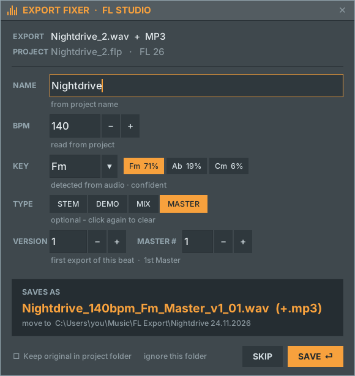
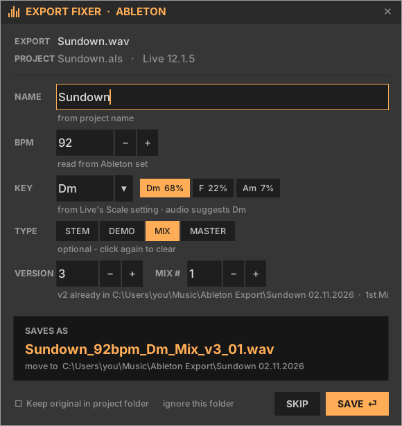

# DAW Export Fixer

**Export a beat from FL Studio or Ableton Live, hit Enter, done.** A small Windows app that watches your FL Studio
and/or Ableton projects folders. When you export, it pops up with the name, BPM, key and next version number
already filled in, then renames the file and files it into one tidy beats folder. Comes with
**Beat Sorter** for your back catalogue: drop old, randomly named exports in and it works out the
BPM and key from the audio. *(Formerly FL Export Namer.)*

 

### [⬇ Download the latest version](https://github.com/jlnorge/daw-export-fixer/releases/latest) · [📖 User guide](https://jlnorge.github.io/daw-export-fixer/)

Windows 10/11 · free · no Python needed. Windows will say the app is from an unknown publisher
(it isn't code-signed) - click **More info → Run anyway**.

## Features
- **BPM straight from the project** - read from the saved `.flp`, not guessed
- **Ableton Live too** - tempo and key (Live's Scale) read from the `.als`; watch FL and Ableton at the same time, each with its own folders and theme
- **Key detection** from the audio, top 3 guesses one click away
- **Automatic versions** - every export of a beat counted (v1, v2…), plus a count per type: pick Stem, Demo, Mix or Master (`SynthTrap_120bpm_Fm_Master_v8_01`); nothing is ever overwritten
- **Tidy folders** - one folder per beat, dated by its first export (`Nightdrive 24.11.2026`)
- **Remembers** each project's name and key, so re-exports are usually one keypress
- **Stems and multi-format** - WAV + MP3 = one version; stems get their own folder
- **Beat Sorter** - drop old files or whole folders; BPM + key estimated, file-name clues used, junk stripped
- **Safety net** - undo, copy instead of move, skip, pause
- **Your format** - file-name pattern, key style, sharps/flats, folder layout
- **Update notices** - tells you when a new version is out

## Found a bug / got an idea?
[Open an issue](https://github.com/jlnorge/daw-export-fixer/issues/new/choose) - attach your log
(tray icon → **Open log**) for bugs.

---

## For the developer

| | |
|---|---|
| Run from source | `py -m pip install -r requirements.txt` then `py daw_export_fixer.pyw` (watcher) / `py beat_sorter.pyw` / `py daw_export_fixer.pyw --demo` |
| Tests | `py -m pip install -r requirements-dev.txt` then `py -m pytest tests` |
| Local build | double-click `build_kit\build.bat` → `dist\` |
| Release | add a `CHANGELOG.md` section, bump `__version__` in `namer_core.py`, merge to `main`, then **Actions → release → Run workflow** |
| Guide | edit `docs/index.html` - it republishes automatically when merged to `main` |

How the code is laid out, and the rules for changing it: [`CLAUDE.md`](CLAUDE.md).
